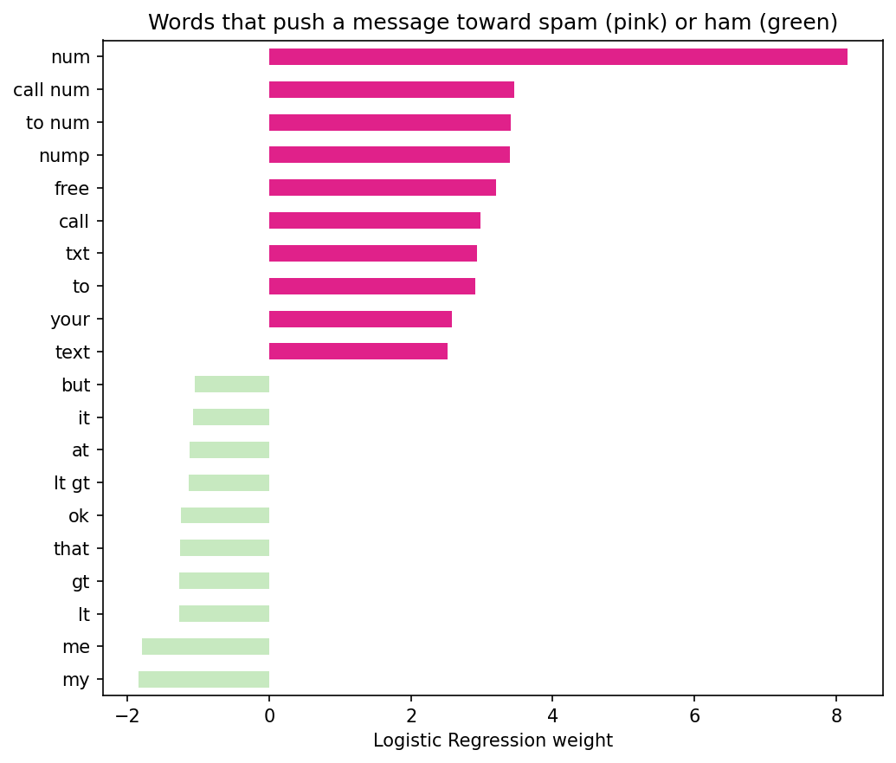

# 📱 SMS Spam Classifier

A machine learning model that classifies SMS messages as **spam** or **ham** (not spam), built with scikit-learn.

<!-- TODO: once it's working, replace this with one line about your result, e.g.
"Logistic Regression with TF-IDF features reaches 98% accuracy and 0.93 spam F1 on held-out data." -->

## How it works

1. **Clean** the text: lowercase, strip punctuation, replace URLs and numbers with tokens
2. **Vectorize** with TF-IDF (words and two-word phrases)
3. **Train** and compare Multinomial Naive Bayes and Logistic Regression
4. **Evaluate** on a stratified 20% test set using precision, recall and F1

## Results

Both models were evaluated on a held-out test set of 1,115 messages (966 ham, 149 spam).

| Model | Spam precision | Spam recall | Spam F1 | Accuracy |
|---|---|---|---|---|
| Multinomial Naive Bayes | **1.00** | 0.81 | 0.90 | 0.97 |
| Logistic Regression | 0.98 | **0.88** | **0.93** | **0.98** |

**Logistic Regression performed best**, with a spam F1 of 0.93.

- **Naive Bayes** was the most cautious: every message it flagged was truly spam (precision 1.00), but it missed about 1 in 5 spam messages (recall 0.81).
- **Logistic Regression** caught more spam (88%) while still almost never flagging a real message by mistake (precision 0.98), giving the better overall balance.

**Why not just look at accuracy?** About 87% of the test messages are ham, so a model that predicts "ham" every time would score 86.6% accuracy while catching zero spam. Spam precision and recall give a much more honest picture.




## Run it yourself

```bash
git clone https://github.com/Kawtharthun/sms-spam-classifier.git
cd sms-spam-classifier
pip install -r requirements.txt
# download the dataset into data/ (see data/README.md)
jupyter notebook spam_classifier.ipynb
```

## Dataset

[SMS Spam Collection](https://archive.ics.uci.edu/dataset/228/sms+spam+collection) (UCI): 5,574 English SMS messages labeled ham or spam.

## What I learned

- **Accuracy can be misleading on imbalanced data.** About 87% of the messages are ham, so a model that always predicts "ham" would score 86.6% accuracy while catching zero spam. Spam precision, recall and F1 tell the real story.
- **Precision and recall trade off, and the right balance depends on the cost of each mistake.** Naive Bayes never flagged a real message as spam (precision 1.00) but missed 19% of spam. Logistic Regression caught more spam (88%) at the cost of a few false alarms. For a real spam filter, losing an important message is often worse than letting one spam through, so the "best" model depends on the use case.
- **Avoiding data leakage.** The TF-IDF vectorizer is fit only on the training set. Fitting it on the test data would leak information about "unseen" messages into the model and make the scores look better than they really are.
- **Simple models can be explained.** Logistic Regression's weights show exactly which words drive its decisions. Replacing links and numbers with `url` and `num` paid off: both became among the strongest spam signals, while personal words like "i", "my" and "me" pointed strongly to ham.
- **`stratify` keeps the test set realistic.** With only ~13% spam, a purely random split could give a test set with too much or too little spam. Stratifying keeps the same ratio in both sets.

## Next steps

- **Tune the decision threshold:** spam is currently predicted at probability ≥ 0.5. Raising or lowering it would let me choose the precision/recall balance on purpose.
- **Try more models:** compare against a Linear SVM and a Random Forest.
- **Use cross-validation:** evaluate across 5 different train/test splits for a more reliable score than a single split.
- **Look at the mistakes:** study the spam messages the model missed to find patterns it can't yet recognize.
- **Build a demo:** a small Streamlit web app where anyone can type a message and get a live prediction.